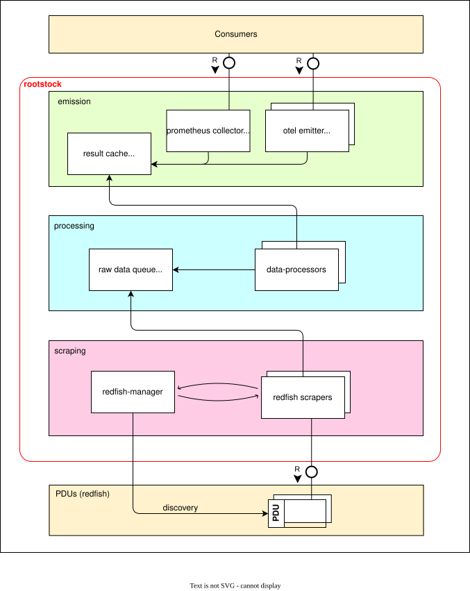

# Design

- [Design](#design)
  - [1. Overview](#1-overview)
    - [1.1 Background](#11-background)
    - [1.2 Problem statement](#12-problem-statement)
    - [1.3 Scope](#13-scope)
  - [2. Requirements](#2-requirements)
    - [2.1 Functional Requirements](#21-functional-requirements)
    - [2.2 Scalability](#22-scalability)
    - [2.3 Security](#23-security)
      - [2.3.1 Device access (PDUs)](#231-device-access-pdus)
      - [2.3.2 SCI prometheus access](#232-sci-prometheus-access)
      - [2.3.3. SCI Netbox access](#233-sci-netbox-access)
      - [2.3.4 Other consumer access](#234-other-consumer-access)
    - [2.4 SLOs, Validations, Metrics \& Alerts](#24-slos-validations-metrics--alerts)
      - [2.4.1 SLOs](#241-slos)
      - [2.4.2 Performance testsuites](#242-performance-testsuites)
      - [2.4.3 Health \& Readiness probes](#243-health--readiness-probes)
      - [2.4.4 Observability metrics](#244-observability-metrics)
      - [2.4.5 Alerts](#245-alerts)
  - [3. Service structure](#3-service-structure)
    - [3.1 Scraping layer](#31-scraping-layer)
      - [3.1.1 Redfish manager](#311-redfish-manager)
      - [3.1.2 Redfish scraper](#312-redfish-scraper)
      - [3.1.1 SNMP collector](#311-snmp-collector)
    - [3.2 Processing layer](#32-processing-layer)
      - [3.2.1 Ingestion queue](#321-ingestion-queue)
      - [3.2.2 Processor](#322-processor)
    - [3.3 Emissions layer](#33-emissions-layer)
      - [3.3.1 Result queue](#331-result-queue)
      - [3.3.2 Prometheus Collector](#332-prometheus-collector)
      - [3.3.2 Otel Exporters](#332-otel-exporters)
  - [4. Communication interfaces](#4-communication-interfaces)
    - [4.1. HTTP server endpoints (rootstock)](#41-http-server-endpoints-rootstock)
      - [4.1.1 Metrics](#411-metrics)
      - [4.1.2 Health and Readiness](#412-health-and-readiness)
    - [4.2. Redfish server interface](#42-redfish-server-interface)

## 1. Overview

### 1.1 Background

Due to the EU legislation and increased efforts to implement sustainability
goals, this project aims to collect real-time energy consumption data for
datacenters and break it down to individual consumers.

### 1.2 Problem statement

Rootstock must collect sustainability-related metrics for available devices and
vendors so that sustainability targets for datacenters can be tracked.

Interesting data for collection are

- energy consumption [kWh]
- power [VA] [wiki](https://en.wikipedia.org/wiki/AC_power#Apparent_power)
  - apparent
  - reactive
  - active
  - powerfactor

### 1.3 Scope

The initial scope of the rootstock project is to collect energy consumption data
from power distribution units [PDU]s. This data will be made available in
Prometheus.

Future scope enhancements may be:

- energy consumption data for individual machines (either direct measurements or
  weighted distributions based on CPU utilisation)
- energy consumption data from the whole data-center to distribute loss data
  across all devices
- energy consumption calculation for VMs if possible
- energy consumption calculation for containers if possible
- all-in-one solution in 1 service from raw-data collection to the exposure of
  metrics via open-telemetry [OTEL] collectors
- additional OTEL collectors for metrics emmission

## 2. Requirements

To be generally useful, rootstock has to fulfil a set of business and technical
requirements. These are listed in this section.

### 2.1 Functional Requirements

Core functionality that must be implemented:

- **PDU Discovery and Configuration**: Support for static configuration of PDU
  targets. If possible, extend to dynamic PDU target discovery
- **Asynchronous scraping**: Periodically scrape current metrics from all
  available PDUs with
  [redfish protocol](https://redfish.dmtf.org/redfish/schema_index).
- **Ingestion endpoint**" Offer an ingestion endpoint for non-redfish PDU
  metrics.
- **Metric Processing**: Process incoming raw metrics to a standardised
  rootstock schema and enhance the output data where possible.
- **Metric Exposition**: Expose the result metrics via Prometheus and further
  OTEL collectors

### 2.2 Scalability

Since rootstock will be installed into every datacenter, it has to be able to
process all devices within 1 datacenter. Notice, that the longterm plan for
rootstock includes metric processing of further types of devices like servers,
routers, and other. Hence, rootstock must be able to continuously scrape and or
process metrics from hundreds of devices of various types.

Until proven wrong, we assume that vertical scaling is sufficient. Scalability
is achieved mainly by adding concurrency for long running processes. Concretely,
`scrapers` and `data-processors` are implemented through workers in dedicated
coroutines.

TODO: implement

### 2.3 Security

#### 2.3.1 Device access (PDUs)

TODO: specify

- credentail injection via vault

#### 2.3.2 SCI prometheus access

To secure the endpoints for prometheus pull-based scraping, we use a kubernetes
role that restricts access to this endpoint solely to requests originating from
the prometheus namespace.

TODO: implement

#### 2.3.3. SCI Netbox access

TODO: specify

#### 2.3.4 Other consumer access

TODO: specify

- access keys
- certificates

### 2.4 SLOs, Validations, Metrics & Alerts

To ensure that rootstock works reliably, we define SLOs and suitable validation
instruments (testsuites, runtime metrics, alerts).

#### 2.4.1 SLOs

TODO

#### 2.4.2 Performance testsuites

TODO

#### 2.4.3 Health & Readiness probes

TODO

#### 2.4.4 Observability metrics

TODO: update

Rootstock itself will emit observability metrics to report its working
conditions:

- \# monitored redfish PDUs
- processing time
- queue length

#### 2.4.5 Alerts

TODO

## 3. Service structure



In general, rootstock is implemented as a cobra CLI. Internallly, it splits into
3 layers: scraping, processing, and metric emission.

### 3.1 Scraping layer

TODO: add details on implementation

#### 3.1.1 Redfish manager

TODO: add details on implementation

#### 3.1.2 Redfish scraper

TODO: add details on implementation

#### 3.1.1 SNMP collector

TODO: add details on implementation

### 3.2 Processing layer

TODO: add details on implementation

#### 3.2.1 Ingestion queue

TODO: add details on implementation

#### 3.2.2 Processor

TODO: add details on implementation

### 3.3 Emissions layer

TODO: add details on implementation

#### 3.3.1 Result queue

TODO: add details on implementation

#### 3.3.2 Prometheus Collector

TODO: add details on implementation

- consolidate with [prometheus.md](./prometheus.md)

#### 3.3.2 Otel Exporters

TODO: add details on implementation

## 4. Communication interfaces

### 4.1. HTTP server endpoints (rootstock)

#### 4.1.1 Metrics

TODO: refine

```text
GET /metrics?target=<host>
```

**Description:** Main endpoint for Prometheus scraping using multi-target
pattern.

**Response:** Prometheus exposition format with PDU metrics

#### 4.1.2 Health and Readiness

TODO: refine

```text
GET /health   # Liveness probe
GET /ready    # Readiness probe
```

### 4.2. Redfish server interface

This section specifies the expected REST interface on the redfish device side.

TODO
