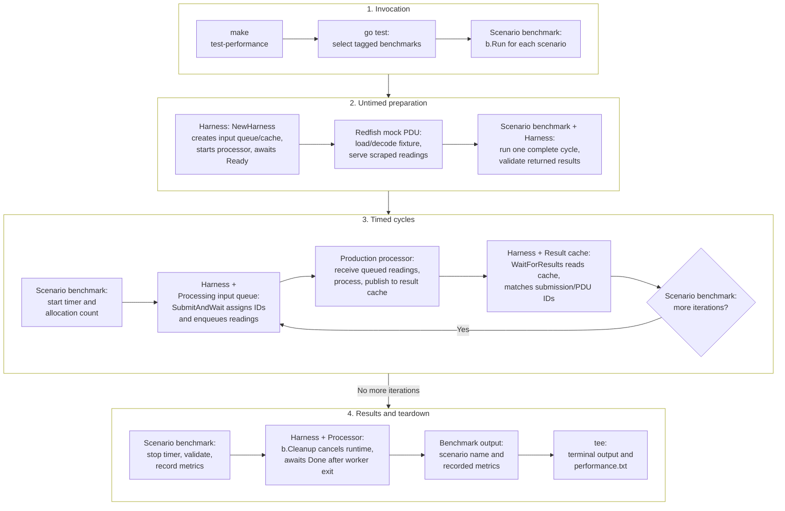

# Performance testing

Rootstock's performance suite measures asynchronous processing using a
submit-and-await harness. One unit of work is:

```text
One unit of work is a single scraped reading submitted to the processing input queue, processed asynchronously, and published as its corresponding result in the result cache.
```

A cycle submits one or more readings and completes only when every submission
has its corresponding result in the cache. For N readings, one benchmark
operation is the complete N-item cycle.

## Current status

The production processor is not implemented. Full-pipeline tests and benchmarks
therefore **skip**, with a message identifying the missing connection point,
rather than waiting for a guaranteed timeout. They produce no performance
measurements yet.

Connect `startProductionProcessor` in
`test/performance/redfish_pipeline_test.go` to a production adapter implementing
`performance.StartProcessor` when the processor becomes available. The adapter
must preserve submission identity through processing and cache publication.

Harness unit tests run today using an asynchronous test-only processor. These
verify queueing, repeated cycles, concurrent producers, submission matching,
timeouts, cancellation, and worker shutdown. This test processor is never used
as a performance benchmark substitute.

## Structure and shared modules

```text
test/performance/
  scenario_types.go           Data types, source/processor contracts, configuration
  harness.go                  Queue/cache ownership, startup, cycles, teardown
  harness_test.go             Performance harness unit tests
  result_wait.go              Wait for the current submissions' cache results
  result_wait_test.go         Submission-aware waiting tests
  redfish_pipeline_test.go    Redfish correctness scenarios and benchmarks
  mockpdu/
    mockpdu.go                Redfish fixture paths and JSON loading
    redfish.go                Fixture-backed RedfishSource
    redfish_test.go           Fixture loading, device identity, and copy isolation
    snmp.go                   Future SNMP source entry point
```

The harness is protocol-neutral. A future SNMP scenario can reuse it by
providing a `Source` implementation. `NewSNMP` currently returns an error
because SNMP fixtures are not implemented.

Redfish fixtures come from `testdata/pdu-mockup`, shared with integration tests.
They are decoded during mock construction. Scaled mock sources expose stable,
distinct PDU IDs; the scraped reading uses the source's PDU ID rather than the
fixture document's metrics-resource ID.

The fixture location is explicit:

```go
source, err := mockpdu.NewRedfishScaled("../../testdata/pdu-mockup", pduCount)
```

Go runs tests from their package directory, so the performance suite supplies a
path relative to `test/performance`. The constructors also accept absolute
paths. The supplied directory must contain
`redfish/v1/PowerEquipment/RackPDUs/1/index.json` and
`redfish/v1/PowerEquipment/RackPDUs/1/Metrics/index.json`. The mock package does
not search for the repository root or inspect Go source-file locations.

## Benchmark execution

`make test-performance` runs the benchmark scenarios shown below. The diagram
assumes the production processor is connected and working; its workers process
queued readings independently of the harness.



- **Prepare:** Start an isolated processor runtime, scrape the mocked PDUs, and
  validate an untimed warm-up cycle. Reuse the queue, cache, and workers across
  iterations to measure steady-state behavior.
- **Measure:** Submit already-scraped readings to the processing input queue and
  wait for all matching cache results. Timing includes queueing, processing, and
  completion observation; setup, scraping, warm-up, validation, and teardown are
  excluded. Submission IDs prevent stale results from completing a new cycle.
- **Finish:** Record timing and allocation metrics, stop and join the workers,
  and write benchmark output to the terminal and `performance.txt`. Deadlines
  bound execution and cleanup; failures cancel the runtime.

Concurrent scenarios give each producer distinct PDU inputs and measure
closed-loop throughput. Cache polling contributes to measured completion
latency. `TestRedfishPipeline` exercises the same pipeline for correctness,
without reporting performance metrics.

## Scenarios

| Benchmark                                 | Workload                                         | Measurement                            |
| ----------------------------------------- | ------------------------------------------------ | -------------------------------------- |
| `BenchmarkRedfishProcessing/single`       | One reading, one worker                          | Enqueue-to-result completion latency   |
| `BenchmarkRedfishProcessing/batch/pdus=N` | 10, 100, or 1000 readings; four workers          | Complete-batch duration and throughput |
| `BenchmarkRedfishProcessingConcurrent`    | 2, 4, or 8 independent producers; 1 or 4 workers | Concurrent completion throughput       |

## Running

```sh
# Performance harness unit tests, including race detection.
go test -race ./test/performance/...

# Include the full-pipeline correctness scenarios (currently skipped).
go test -race -tags=performance ./test/performance/...

# Benchmarks only; output is also written to performance.txt.
make test-performance
```

Full-pipeline scenario files use the `performance` build tag. Shared harness
code and its unit tests are untagged, so ordinary `go test ./...` verifies the
harness without running performance scenarios.

The Makefile exposes these overrides:

- `PERFTEST_TIME`: `-benchtime`, default `2s`.
- `PERFTEST_COUNT`: `-count`, default `1`; use repeated runs for comparisons.
- `PERFTEST_CPU`: `-cpu`, default `1`; sets `GOMAXPROCS`, not CPU affinity.
- `PERFTEST_TIMEOUT`: `-timeout`, default `10m`.

```sh
make test-performance PERFTEST_TIME=5s PERFTEST_COUNT=6 PERFTEST_CPU=4 PERFTEST_TIMEOUT=3m
```

The benchmark command uses `pipefail` so `tee` cannot hide benchmark failures.
Race detection runs separately from timing measurements.

## Interpreting results

| Metric      | Meaning                                                                                |
| ----------- | -------------------------------------------------------------------------------------- |
| `ns/op`     | One complete cycle (one result for single/concurrent scenarios; N results for a batch) |
| `ns/result` | Batch duration divided by the number of results                                        |
| `results/s` | Completed results divided by measured time                                             |
| `B/op`      | Heap bytes allocated per cycle                                                         |
| `allocs/op` | Allocations per cycle                                                                  |

For concurrent batches, `ns/result` is amortized time per result, **not
individual result latency**. Individual latency requires per-submission enqueue
and completion timestamps. Parallel `ns/op` likewise reflects aggregate
throughput, not individual response latency.

Compare repeated runs using `benchstat` on comparable hardware with the same Go
version and workload configuration. Record worker counts, queue capacities, and
polling interval alongside results.

## Testing strategy

The suite runs in code, without network traffic, deployed containers, or
Prometheus scrapes. This isolates processing cost. A deployment-level load test
can be added later if broader end-to-end behavior needs measurement.

The intended benchmark checkpoints are on-commit, on-automerge, and on-release.
Public GitHub runners can produce noisy measurements; consider a dedicated
runner if that prevents meaningful comparisons.

## Open questions

### Prometheus collector benchmarks

A future collector benchmark could gather metrics from a statically populated
result cache to measure collection and exposition independently from processing.
That is a separate workload from this submit-and-await suite; its fixture and
runtime wiring still need to be designed.
