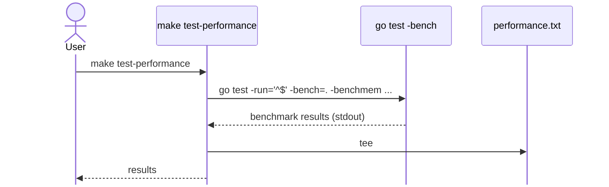
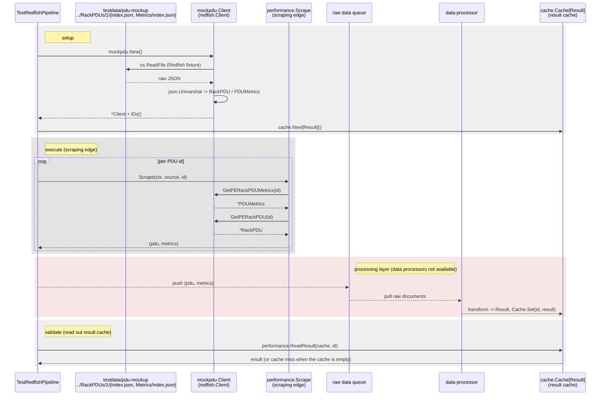

# Performance testing

This document describes how rootstock's performance is benchmarked. The suite
measures the end-to-end pipeline for a PDU (virtual Redfish device -> scraper ->
processing layer -> result cache) to track relative component performance and
detect regressions.

The Redfish scenario is currently not completely implemented: the data
processors (the raw data queue and data-processor of the processing layer) are
not available, so the end-to-end pass does not yet run to completion.

## Overview

All performance tests and benchmarks live in a single consolidated suite under
`test/performance` (package `performance`), rather than scattered across the
packages they measure. The suite runs entirely in-code: no network, deployed
container, or Prometheus scrape is involved, so the measurement isolates
processing cost.

The suite is gated behind the `performance` build tag (`//go:build performance`
on the test files), so a plain `go test ./...` skips it; it runs only when the
tag is requested, which `make test-performance` does. This mirrors how the
integration tests are gated behind the `integration` build tag.

## Running the benchmarks

```sh
make test-performance
```

This runs benchmarks only (unit tests are excluded via `-run=^$`), builds with
`-tags=performance` to include the gated suite, and writes the
benchstat-compatible output to `performance.txt`. The invocation is defined in
the `test-performance` Makefile target. Four flags are exposed as environment
variables you can override:

- `PERFTEST_TIME` (`-benchtime`, default `2s`): wall-time budget per benchmark.
- `PERFTEST_COUNT` (`-count`, default `1`): number of runs per benchmark; raise
  (e.g. `6`) when feeding `benchstat`.
- `PERFTEST_CPU` (`-cpu`, default `1`): pins `GOMAXPROCS` for reproducibility.
- `PERFTEST_TIMEOUT` (`-timeout`, default `10m`): a hard ceiling so a run can
  never hang the pipeline.

For example:

```sh
make test-performance PERFTEST_TIME=5s PERFTEST_COUNT=6 PERFTEST_CPU=4 PERFTEST_TIMEOUT=3m
```

The target package (`./test/performance/...`) and output file
(`performance.txt`) are fixed in the target.

## Interpreting the results

```text
ns/op      average time per operation   (lower is faster)
B/op       heap memory per operation    (lower is leaner)
allocs/op  heap allocations per op      (watch this first for regressions)
```

Absolute values are machine-specific (see `goos`/`goarch`/`cpu`); compare runs
on identical hardware. Scaled benchmarks should grow ~linearly with the item
count.

## What is covered

The suite benchmarks the path from a mocked PDU through processing into the
result cache:

- `BenchmarkPipeline`: a single representative device.
- `BenchmarkPipelineScale`: how cost grows with the number of devices (mass
  scanning / horizontal scaling).
- `BenchmarkPipelineParallel`: concurrent processing.
- `TestRedfishPipeline`: the end-to-end Redfish test case. It sets up and
  connects mock PDUs to the scraper, executes, and validates by reading out the
  result cache.

Because the data processors are not available, the full pipeline pass (scrape ->
queue -> processor -> cache) does not run to completion; the benchmarks and
`TestRedfishPipeline` scrape the mocked PDUs and then report the missing
processing layer.

## How it works

### Harness and mock PDU

- `test/performance/mockpdu`: an implementation of `redfish.Client` backed by
  fixtures. Fixtures are read once at construction from the DMTF Redfish PDU
  mockup under `testdata/pdu-mockup` (the same data the integration tests use,
  so there is a single source of truth), decoded before the benchmark timer
  starts so per-iteration cost reflects processing, not JSON parsing or network
  I/O.
- `test/performance/harness.go`: the ends of the pipeline, namely
  `performance.Scrape` (the scraping edge, over the `redfish.Client`) and
  `performance.ReadResult` (the result-cache read-out). The processing layer
  that connects them is described in
  [architecture.md](../design/architecture.md).

### Invocation flow

The order of operations to run the tests, from user invocation to interpreted
results:



### Redfish test case component chain

The component chain for the Redfish test case, from the mocked fixture through
to validation by reading out the result cache, mirroring `TestRedfishPipeline`
in `test/performance/harness_test.go`. The processing-layer stage (dashed)
depends on the data processors, which are not available.



## Testing strategy & decisions

### Test cases

Two cases are run directly at the code level, verifying the processing pipeline
at the result cache using a static set of mocked PDUs:

1. SNMP PDUs
2. Redfish PDUs

A later option is to test at the Prometheus collector using a statically filled
result cache (see [Open questions](#open-questions)).

### Where and how often we run

Fail early: cheaper tests run at earlier stages. Benchmarks run:

- on-commit
- on-automerge
- on-release

For now, tests run on a public GitHub runner. A public virtualized environment
will probably cause erratic absolute measurements; depending on how erratic it
is, we can consider self-hosting a runner later.

### Why not against a deployment

We do not benchmark rootstock running as a deployed container in a Kubernetes
(kind) cluster. The goal is to measure the relative performance of the relevant
components and detect regressions, which the in-code benchmarks achieve without
the variance and overhead of a full deployment. Benchmarking a deployed
container may be reconsidered if we later need to measure end-to-end behaviour
that the component-level benchmarks cannot capture.

## Open questions

### Performance-testing the Prometheus collector

Test the Prometheus collector with the result cache (buffer) set static:

- Measures peak requests per second and response time.
- Requires a feature flag to set the cache static.
- Security risk if the flag is enabled in production, so the risk/reward is
  potentially low.
