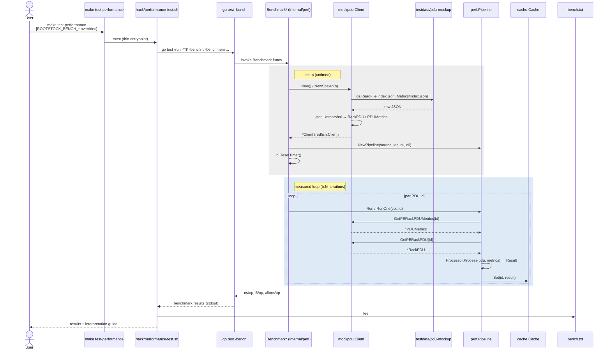

# Performance testing

This document describes the performance-testing approach for rootstock and the
metrics we intend to measure.

## Notes

### Do we need to adhere to SAPs product standards

We don't need to adhere to SLC (pipeline) standards. SCI is exempt. Also, this
project is not supposed to be owned by SAP in the future. We want transparent
pipeline runs and builds to open registries

### Should we run the tests on a public github runner?

yes, for now. running tests on a public virtualized environment will probably
cause erratic absolute response measurements. depending on how erratic it is, we
can consider self-hosting our own runner later on.

### How often and when do we test?

test frequency -> fail early. which stage the tests run depends on how expensive
(runtime) they are if cheaper, higher up

- on-commit
- on-automerge
- on-release

### Test Cases

we will test two initial cases for rootstock

we run two test cases directly at the code level. At the result cache, we verify
the performance of the processing pipeline using a static set of mocked

1. SNMP PDUs
2. redfish PDUs

later, we can test at the prometheus collector using a statically filled result
cache. see
[Open Questions](#do-we-want-to-performance-test-the-prometheus-collector)

### Do we performance test against a deployment of rootstock?

testing against the deployed container in a kind cluster is currently off the
table as we deem it not necessary to benchmark test relevant components and
measuring relative deviations.

## Open questions

### Do we want to performance test the prometheus collector

(and set the result cache (buffer) static)?

- measures peak request per second and response time
- requires feature flag to set the cache static
- security risk if you enable the flag in production -> risk / reward
  potentially low

## In-code benchmark harness

The native Go benchmarks live beside the code they measure and are driven by a
reusable harness under `internal/perf`:

- `internal/perf/mockpdu` — an implementation of `redfish.Client` using
  fixtures. Fixtures are read once at construction from the DMTF Redfish PDU
  mockup under `testdata/pdu-mockup` (the same data the integration tests use,
  so there is a single source of truth), decoded before the benchmark timer
  starts so per-iteration cost reflects processing, not JSON parsing or network
  I/O.
- `internal/perf/harness.go` — the `Pipeline` that wires the three measured
  stages together: mock PDU source → `Processor` → result cache. The benchmark
  observes results landing in the abstract result cache, which is the
  measurement point described above.

### Coverage

`internal/perf` benchmarks the full path from a mocked PDU through processing
into the result cache:

- `BenchmarkPipeline` measures a single representative device.
- `BenchmarkPipelineScale` measures how cost grows with the number of devices
  (mass scanning / horizontal scaling).
- `BenchmarkPipelineParallel` measures concurrent processing.

`internal/collectors/cache` benchmarks the result cache in isolation:

- `BenchmarkCacheSet` and `BenchmarkCacheGet` measure the cache under sequential
  load.
- Their `Parallel` variants measure the cache under contention.

### Chain of operations

From user invocation to interpreted results. The one-time setup (reading the
mockup fixtures and assembling the pipeline) happens before the benchmark timer
starts; only the loop between `b.ResetTimer()` and the end of `b.N` is measured.



### Running the benchmarks

```sh
make test-performance
```

This runs benchmarks only (unit tests are excluded via `-run=^$`), writes the
benchstat-compatible output to `bench.txt`, and never touches the network or a
mockup container. Tunables (with defaults) can be overridden on the command
line, e.g.:

```sh
make test-performance ROOTSTOCK_BENCH_TIME=5s ROOTSTOCK_BENCH_COUNT=6 ROOTSTOCK_BENCH_CPU=1
```

`ROOTSTOCK_BENCH_CPU=1` pins `GOMAXPROCS` for reproducibility;
`ROOTSTOCK_BENCH_TIMEOUT` is a hard ceiling so a run can never hang the
pipeline. All `ROOTSTOCK_BENCH_*` knobs are defined in
`hack/performance-test.sh`. A CI quality gate and a stored baseline for
regression comparison are deliberately deferred until the benchmark runtimes are
known.
