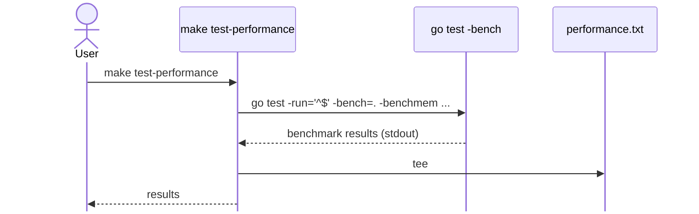
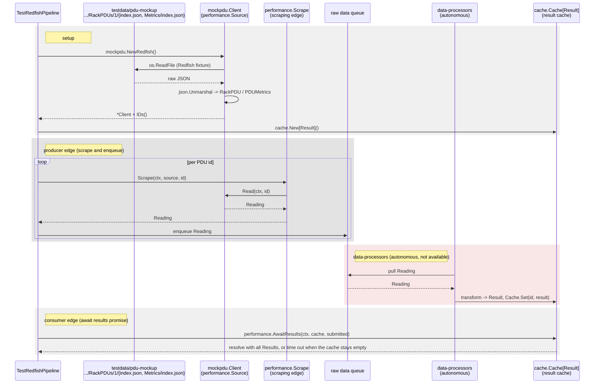

# Performance testing

This document describes how rootstock's performance is benchmarked. The suite
owns the producer and consumer ends of the pipeline for a PDU (virtual Redfish
device -> scraper -> enqueue onto the raw data queue, then read back from the
result cache) to track relative component performance and detect regressions.
The data-processors between the queue and the result cache are an autonomous
entity and are not driven by the suite.

The Redfish scenario is currently not completely implemented: the
data-processors are not available, so nothing drains the raw data queue into the
result cache and the pass does not yet run to completion.

## Overview

All performance tests and benchmarks live in a single consolidated suite under
`test/performance` (package `performance`), rather than scattered across the
packages they measure. The suite runs entirely in-code: no network, deployed
container, or Prometheus scrape is involved, so the measurement isolates
processing cost.

The suite's result cache (`cache.Cache[Result]`) is an in-test stand-in for the
architecture's in-service result cache component; it is the measurement endpoint
where processed results land.

The suite is gated behind the `performance` build tag (`//go:build performance`
on the test files), so a plain `go test ./...` skips it; it runs only when the
tag is requested, which `make test-performance` does. This mirrors how the
integration tests are gated behind the `integration` build tag.

## Running the benchmarks

```sh
make test-performance
```

This runs benchmarks only (unit tests are excluded via `-run=^$`), builds with
`-tags=performance` to include the gated suite, and writes the
benchstat-compatible output to `performance.txt`. The invocation is defined in
the `test-performance` Makefile target. Four flags are exposed as environment
variables you can override:

- `PERFTEST_TIME` (`-benchtime`, default `2s`): wall-time budget per benchmark.
- `PERFTEST_COUNT` (`-count`, default `1`): number of runs per benchmark; raise
  (e.g. `6`) when feeding `benchstat`.
- `PERFTEST_CPU` (`-cpu`, default `1`): pins `GOMAXPROCS` for reproducibility.
- `PERFTEST_TIMEOUT` (`-timeout`, default `10m`): a hard ceiling so a run can
  never hang the pipeline.

For example:

```sh
make test-performance PERFTEST_TIME=5s PERFTEST_COUNT=6 PERFTEST_CPU=4 PERFTEST_TIMEOUT=3m
```

The target package (`./test/performance/...`) and output file
(`performance.txt`) are fixed in the target.

## Interpreting the results

```text
ns/op      average time per operation   (lower is faster)
ns/pdu     per-PDU time (BenchmarkPipelineScale, comparable across N)
B/op       heap memory per operation    (lower is leaner)
allocs/op  heap allocations per op      (watch this first for regressions)
```

Absolute values are machine-specific (see `goos`/`goarch`/`cpu`); compare runs
on identical hardware. Scaled benchmarks should grow ~linearly with the item
count.

While the data-processors are not available, the test and all benchmarks fail by
timeout (each unit waits `resultTimeout`, 5s, for results that never arrive), so
no ns/op is reported yet. This is expected, not a flake.

## What is covered

The unit of work the suite measures is one PDU making a full pass through the
pipeline: scraped, submitted for processing (enqueued onto the raw data queue),
processed by the data-processors, and its result received from the result cache.
Every benchmark and the test exercise this same unit:

- `BenchmarkPipeline`: the per-PDU unit for a single representative device.
- `BenchmarkPipelineScale`: the same per-PDU unit while N devices are in flight
  (mass scanning / horizontal scaling). Each iteration runs the full cycle over
  all N PDUs and reports the result normalized per PDU (a `ns/pdu` metric), so
  `pdus=1..1000` compare on one per-PDU axis.
- `BenchmarkPipelineParallel`: the per-PDU unit under concurrency.
- `TestRedfishPipeline`: the Redfish test case. It scrapes and enqueues
  (remembering the submitted IDs), then awaits a promise (`performance.AwaitResults`)
  that resolves once every submitted ID has a Result in the result cache. It
  passes on resolution and fails if the promise does not resolve within a fixed
  timeout (`resultTimeout`, 5s).

The data-processors (raw data queue -> data-processors -> result cache) are an
autonomous entity, not driven by the suite. Because they are not available,
nothing drains the raw data queue into the result cache, so no cycle ever
collects its results: both the test and the benchmarks run the full submit-to-
collect cycle and fail by timeout, reporting that the data-processors are not
implemented. No ns/op (or ns/pdu) is produced until the data-processors exist.

## How it works

### PDU source and mock PDU

- `test/performance/mockpdu`: fixture-backed PDU sources that implement the
  `performance.Source` abstraction (and, for Redfish, the `redfish.Client`
  interface). Each protocol has its own constructor returning a
  `performance.Source`: `NewRedfish` (in `redfish_pdu.go`) loads the Redfish
  fixture, and `NewSNMP` (in `snmp_pdu.go`) is the symmetric SNMP entry point
  used by a future `snmp_processing_test.go`. Both route through the shared
  fixture-loading helpers in `fixtures.go`. SNMP is not implemented yet, so
  `NewSNMP` returns an error until SNMP fixtures exist.
  Fixtures are read once at construction from the DMTF Redfish PDU mockup under
  `testdata/pdu-mockup` (the same data the integration tests use, so there is a
  single source of truth), decoded before the benchmark timer starts so
  per-iteration cost reflects processing, not JSON parsing or network I/O.
- `test/performance/common.go`: the protocol-neutral abstraction and the
  ends of the pipeline, namely the `Source` interface and `Reading` type,
  `performance.Scrape` (the scraping edge, which reads a `Reading` from a
  `Source`) and `performance.ReadResult` (the result-cache read-out). It does not
  depend on any PDU protocol, so adding SNMP means providing a `Source`
  implementation, with no changes to this file. The processing layer that
  connects them is described in
  [architecture.md](../design/architecture.md).

### Invocation flow

The order of operations to run the tests, from user invocation to interpreted
results:



### Redfish test case component chain

The component chain for the Redfish test case, from the mocked fixture through
to validation by awaiting the results from the result cache, mirroring
`TestRedfishPipeline` in `test/performance/redfish_processing_test.go`. The suite
scrapes and enqueues onto the raw data queue, then awaits a promise that resolves
once all submitted results are in the cache. The data-processors stage (dashed)
is autonomous and not driven by the test; it depends on the data-processors,
which are not available, so the promise never resolves and the test times out.



## Testing strategy & decisions

### Test cases

Two cases are run directly at the code level, verifying the processing pipeline
at the result cache using a static set of mocked PDUs:

1. SNMP PDUs
2. Redfish PDUs

A later option is to test at the Prometheus collector using a statically filled
result cache (see [Open questions](#open-questions)).

### Where and how often we run

Fail early: cheaper tests run at earlier stages. Benchmarks run:

- on-commit
- on-automerge
- on-release

For now, tests run on a public GitHub runner. A public virtualized environment
will probably cause erratic absolute measurements; depending on how erratic it
is, we can consider self-hosting a runner later.

### Why not against a deployment

We do not benchmark rootstock running as a deployed container in a Kubernetes
(kind) cluster. The goal is to measure the relative performance of the relevant
components and detect regressions, which the in-code benchmarks achieve without
the variance and overhead of a full deployment. Benchmarking a deployed
container may be reconsidered if we later need to measure end-to-end behaviour
that the component-level benchmarks cannot capture.

## Open questions

### Performance-testing the Prometheus collector

Test the Prometheus collector with the result cache (buffer) set static:

- Measures peak requests per second and response time.
- Requires a feature flag to set the cache static.
- Security risk if the flag is enabled in production, so the risk/reward is
  potentially low.
