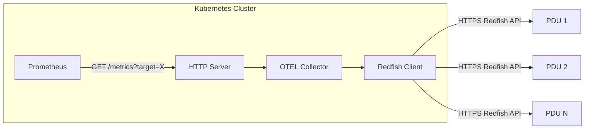

# Architecture

Rootstock is a three-component pipeline. Prometheus scrapes it using the multi-target pattern; rootstock connects to PDUs via Redfish and returns metrics.

## Components

### HTTP Server

Accepts Prometheus scrape requests on `GET /metrics?target=<host>`. Validates the target against the hostname whitelist, routes the request to the OTEL Collector, and returns metrics in Prometheus text format. Handles graceful shutdown.

### OTEL Collector

Receives raw telemetry from the Redfish Client. Processes, enriches, filters, and batches the data. Converts to Prometheus exposition format and routes to the HTTP response.

### Redfish Client

Connects to the PDU over HTTPS using Basic Auth or Session Auth. Queries the Redfish API endpoints, parses the JSON response, and handles timeouts and retries.

## Data flow

```mermaid
sequenceDiagram
    participant P as Prometheus
    participant H as HTTP Server
    participant O as OTEL Collector
    participant R as Redfish Client
    participant PDU as PDU (Redfish)

    P->>H: GET /metrics?target=pdu1.example.com
    H->>H: Validate target (whitelist check)
    H->>R: Collect(target)
    R->>PDU: GET /redfish/v1/ (HTTPS + Basic Auth)
    PDU-->>R: ServiceRoot JSON
    R->>PDU: GET /redfish/v1/PowerEquipment
    PDU-->>R: PowerEquipment JSON
    R->>PDU: GET /redfish/v1/PowerEquipment/RackPDUs
    PDU-->>R: RackPDUs JSON
    R-->>O: Raw telemetry (power, energy, power factor)
    O->>O: Process, enrich, filter, batch
    O-->>H: Prometheus-format metrics
    H-->>P: 200 OK (text/plain; version=0.0.4)
```

## Component diagram



One rootstock pod handles scrapes for all PDU targets. No per-target pods required.

## Redfish endpoints queried

| Endpoint | Purpose |
|---|---|
| `GET /redfish/v1/` | Service root — confirms Redfish availability |
| `GET /redfish/v1/PowerEquipment` | Power equipment index |
| `GET /redfish/v1/PowerEquipment/RackPDUs` | Rack PDU collection with power metrics |

## Metrics collected

| Metric | Unit | Description |
|---|---|---|
| Power consumption | Watts | Current draw per PDU outlet and total |
| Energy usage | kWh | Cumulative energy consumed |
| Power factor | — | Ratio of real to apparent power |

## See also

- [Getting Started](../getting-started) — deploy rootstock
- [Design](./design) — goals, security model, requirements
- [API Reference](../reference/api) — rootstock HTTP endpoints
